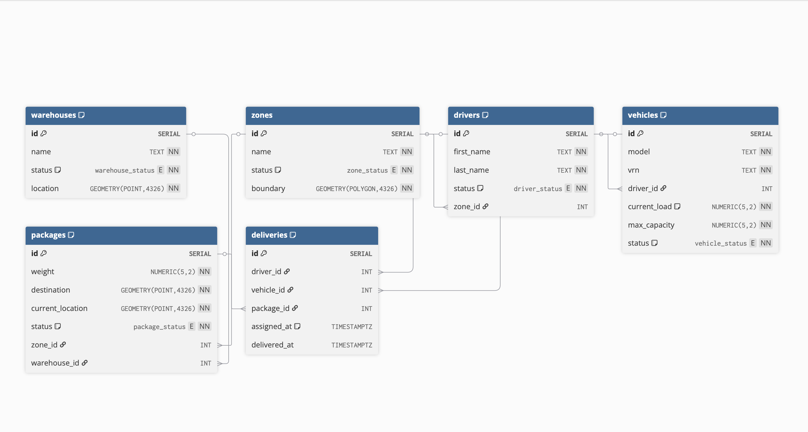

# NetGeo — Charting the last mile 🏃🏻‍♂️🚐

## Tech Stack

`PostgreSQL` `PostGIS` `Python` `scikit-learn` `pandas` `psycopg2`

## Installation

`pip3 install -r requirements.txt`

## The Problem
Small last-mile delivery companies are often stuck between two bad options: spreadsheets that do not scale or enterprise-level logistics platforms that they do not need at their current size. NetGeo is a PostgreSQL/PostGIS backend built for such companies as it runs a geospatial schema that auto-assigns packages to zones, warehouses, drivers and vehicles, flags problems and gets smarter about its own zone boundaries as package volume grows.

*It is built for two users:*

**Logistics coordinators** get full read/write access, a dashboard for delays and orphaned packages (destinations outside any zone), a fleet-management view for vehicle/driver allocation, and automation that handles zone/warehouse/driver/vehicle assignment end to end. Safety checks that stop packages from being routed to decommissioned assets are also included.

**Delivery drivers** only get a restricted view: read delivery info, update package status. 

## Representation

### Entities
The database comprises of **six** tables:

1. _warehouses_
2. _zones_
3. _drivers_
4. _vehicles_
5. _packages_
6. _deliveries_ (Junction Table)

### Relationships

- A `zone` can have zero or many `packages`; a `package` belongs to zero or one `zone` (zero until the auto-zone trigger assigns one)
- A `warehouse` can have zero or many `packages`; a `package` belongs to zero or one `warehouse` (zero if none exists in its zone yet)
- A `zone` can have zero or many `drivers`; a `driver` belongs to zero or one `zone`
- A `driver` has zero or one `vehicle`; a `vehicle` belongs to zero or one `driver`
- A `package` can have zero or many `deliveries` (re-attempts); each `delivery` belongs to exactly one `package`

## Design Choices
To speed up the database during querying, B-tree and GIST indexes have been introduced on select columns based on predicted common queries found in `queries.sql`. **GIST indexes** went on the geometry columns (`location`, `destination`, `current_location`) since those are what power the zone/warehouse containment checks, while **B-trees** went on the columns that get filtered on a lot — `status`, `zone_id`, `warehouse_id`, `assigned_at`. The `zones.boundary` GIST exclusion constraint (stopping zones from overlapping) also gets to reuse this same index instead of needing its own.

**Views** such as _delays_, _orphans_ and _fleet\_management_ are also available to help keep track of key information for optimizing daily operations.

**Three triggers** handle the automation side so none of this has to be done by hand:

- `trg_auto_zone_warehouse` fires whenever a package is inserted or its destination is updated. It checks which active zone contains the destination, and if nothing contains it (an edge case that can happen depending on how the zones were drawn), it just falls back to whichever active zone is closest by distance. Same logic repeats for warehouse: contained-in-zone first, with closest-by-distance as the fallback.
- `tgr_auto_driver_vehicle` fires on delivery insert and looks for an available driver in the package's zone plus a vehicle that actually has room for the package's weight, then assigns both. If it can't find either it just raises a notice instead of failing silently.
- `trg_delivery_status_sync` keeps driver/vehicle/package statuses in sync as deliveries get created and completed, so none of that has to be updated manually and the dashboards stay accurate.

Running all of this synchronously (inside the same transaction as the insert) was a deliberate choice as it means a package genuinely can't exist without at least an attempt at getting assigned, which keeps the data consistent. The tradeoff is written up under Limitations.

## Automation
As more packages pass through the database, they provide valuable information for zone optimisations. Rather than manual zone reallocations, a Python script has been implemented. The algorithm being used is **K-Means Clustering** paired with a **Silhoutte Score** to evaluate spatial separation between zones chosen. In the file `auto_zones.py`, you will find two modes of altering zone boundaries. 

### Mode 1: Adjusting (Mild)
*Usage*: `python3 auto_zones.py adjust`

Under this mode, original zone boundaries are considered. The centre of each zone (centroids) are the starting point for the K-Means Clustering algorithm. Zone boundaries will be slightly altered rather than drastically changed, making it useful for frequent optimisations of the zones.

### Mode 2: Rebalance (Overhaul)
*Usage*: `python3 auto_zones.py rebalance`

In this mode, original zones are not considered. K-Means Clustering algorithm uses 10 sets of fixed centres (random_states = 42) as the starting point for each run, improving the boundaries after each run. This is useful for less frequent zone reallocations such as on a quarterly or yearly basis.

## Adaptability
The database was intentionally designed to be malleable and is able to accommodate use cases beyond a database for delivery companies. For example, by removing the `warehouses` table, renaming the `packages` table to `passengers` amongst other edits, the entire database can be harnessed by a ride-hailing business. With a little bit of imagination and creativity, the sky's the limit!

## Limitations
Scalability for this project could prove to be a bit of a problem. For a mid-sized firm with thousands of packages to deliver, the database should not hit a wall with the aid of indexes on the commonly accessed columns. However, at scale, querying a single flat `packages` or `deliveries` table with millions of rows can slow even with indexes as they grow larger. Furthermore, the triggers, which run synchronously on every single insert/update, can become a bottleneck as they block other transactions until their completion. As such, for a behemoth-sized firm, this database may not be sufficient. 

## Future Improvements
The project, as it stands, has room for improvement. 

One example being the implementation that would be helpful is the introduction of **table partitioning** to aid the scaling problem. Tables such as `deliveries` which contain columns holding date and time can be split up into smaller sub-tables based on specified date ranges, supporting the database to make quicker queries.

Another improvement would be the implementation of **read replicas**. In the event of high read traffic, read replicas allow analytical queries to be offloaded from the primary database, preventing such workloads from competing with live write operations.
